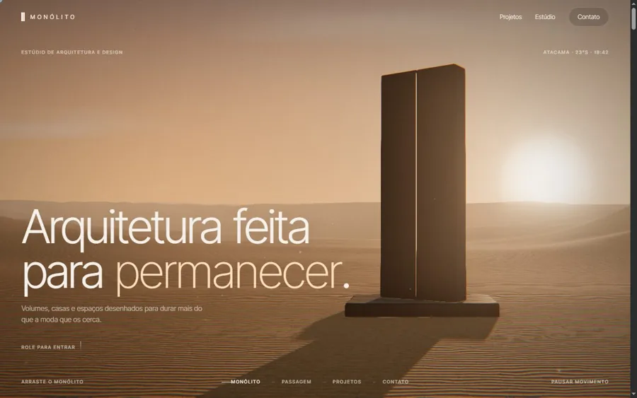
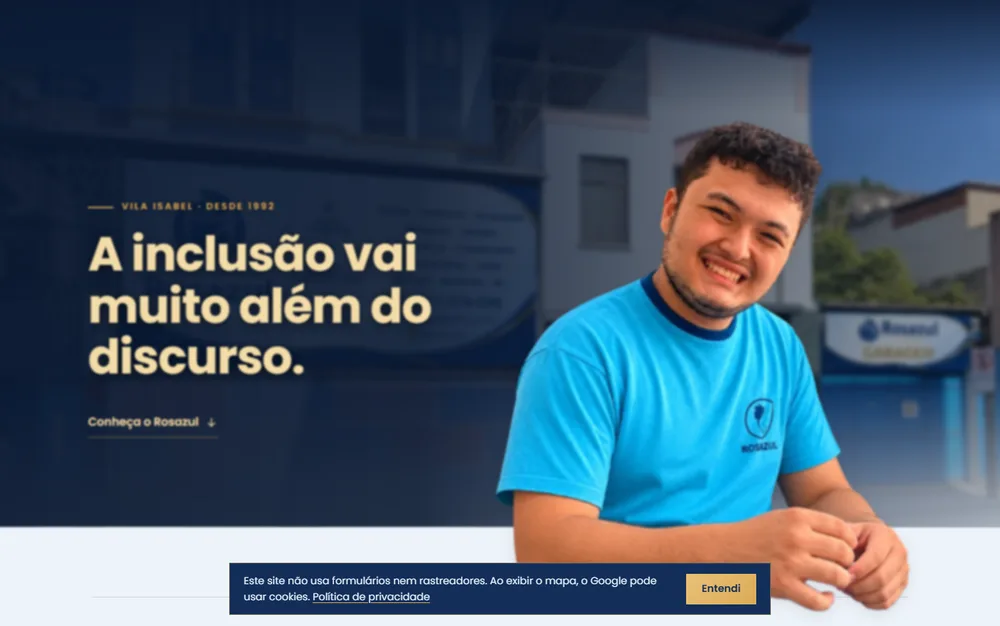

 

Olá! Sou o **Gabriel**, estudante de Análise e Desenvolvimento de Sistemas e desenvolvedor front-end. Crio sites e interfaces com foco em visual cuidadoso, animação fluida e bom desempenho, e uso **IA generativa** como parte do processo, do protótipo ao deploy.

Gosto de projetos que juntam design e engenharia: uma jornada 3D guiada pela rolagem, um site com cena 3D em WebGL, uma vitrine com vídeos otimizados para a web, o site institucional de uma clínica e escola, uma loja com checkout via Pix.

  
  

## Projetos em destaque

<table>
  <tr>
    <td colspan="2" valign="top">
      
      <h3>Monólito</h3>
      
Site de um estúdio de arquitetura fictício feito como <b>uma única jornada 3D guiada pela rolagem</b>: um monólito no deserto se abre, a câmera atravessa um corredor de luz e entra em quatro projetos em escala real, com HDRIs reais, pós-processamento cinematográfico e edifícios modelados no Blender.

      
<code>Three.js</code> <code>WebGL</code> <code>GSAP</code> <code>Lenis</code> <code>Blender</code> <code>JavaScript</code>

      <a href="https://monolito-three.vercel.app">Ver ao vivo</a> · <a href="https://github.com/gabrielnovaesdev/monolito">Código</a>
    </td>
  </tr>
  <tr>
    <td width="50%" valign="top">
      
      <h3>Nébula</h3>
      
Site de um estúdio fictício com <b>orbe de vidro líquido em WebGL</b>, 7 mil partículas em órbita e rolagem cinematográfica, sem nenhum framework.

      
<code>Three.js</code> <code>GSAP</code> <code>Lenis</code> <code>JavaScript</code>

      <a href="https://nebulaproject-nu.vercel.app">Ver ao vivo</a> · <a href="https://github.com/gabrielnovaesdev/Nebula">Código</a>
    </td>
    <td width="50%" valign="top">
      
      <h3>Rosazul</h3>
      
Site institucional de uma <b>clínica multidisciplinar e escola inclusiva</b> em Vila Isabel (RJ): especialidades, equipe, convênios e contato com mapa.

      
<code>HTML</code> <code>CSS</code> <code>JavaScript</code>

      <a href="https://siterosazul.vercel.app/">Ver ao vivo</a>
    </td>
  </tr>
  <tr>
    <td width="50%" valign="top">
      
      <h3>Órbita</h3>
      
Vitrine da linha iPhone 17 com os aparelhos em movimento. Os vídeos foram convertidos para <b>WebM</b>: 80% mais leves e em loop contínuo.

      
<code>JavaScript</code> <code>GSAP</code> <code>Node.js</code> <code>ffmpeg</code>

      <a href="https://orbita-eta-three.vercel.app/">Ver ao vivo</a> · <a href="https://github.com/gabrielnovaesdev/Iphone">Código</a>
    </td>
    <td width="50%" valign="top">
      
      <h3>Clone do Spotify</h3>
      
Recriação responsiva da landing page do Spotify, feita para treinar layout, semântica e responsividade.

      
<code>HTML</code> <code>CSS</code> <code>Bootstrap</code>

      <a href="https://gabrielnovaesdev.github.io/Clone-de-Interface-do-Spotify/">Ver ao vivo</a> · <a href="https://github.com/gabrielnovaesdev/Clone-de-Interface-do-Spotify">Código</a>
    </td>
  </tr>
</table>

### Mais projetos

| Projeto | O que é | Stack |
|---|---|---|
| [NovaeStore](https://github.com/gabrielnovaesdev/NovaeStore) | Loja de jogos digitais com checkout via Pix, pagamento acompanhado em tempo real e webhook seguro · [ver ao vivo](https://gabrielnovaesdev.github.io/NovaeStore/) | React, TypeScript, Supabase |
| [BarberGo](https://github.com/gabrielnovaesdev/BarberGo) | App de barbeiro em domicílio, do agendamento ao acompanhamento do atendimento | React Native, Expo |

<b>Estudos e projetos acadêmicos</b>

 

| Projeto | O que é | Stack |
|---|---|---|
| [APS_POO](https://github.com/gabrielnovaesdev/APS_POO) | Projeto em grupo de Programação Orientada a Objetos | Java |
| [Estudos-C](https://github.com/gabrielnovaesdev/Estudos-C) | Lógica, estruturas e registros em C e C++ | C, C++ |
| [Estudos](https://github.com/gabrielnovaesdev/Estudos) | Algoritmos em pseudocódigo no VisuAlg | Portugol |
| [Blog-tecnol-gico](https://github.com/gabrielnovaesdev/Blog-tecnol-gico) | Layout de blog, um dos primeiros projetos web | HTML, CSS |
| [Jogo-da-velha](https://github.com/gabrielnovaesdev/Jogo-da-velha) | Jogo para dois jogadores no navegador | JavaScript, jQuery |

## Stack

  

  

**IA no dia a dia:** uso modelos generativos para prototipar, revisar código e automatizar tarefas repetitivas.

  
  
  
  
  

## Agora

- Aprofundando em React, TypeScript e back-end serverless com Supabase
- Estudando animação para a web com GSAP e WebGL
- Estudando automação de processos com IA

 

Aberto a oportunidades e projetos. Me chame no <a href="https://linkedin.com/in/gabrielnovaesdev">LinkedIn</a>.
