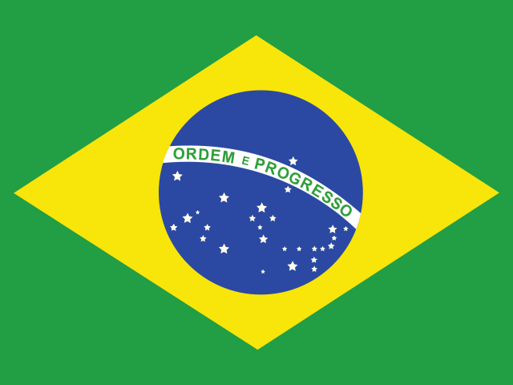
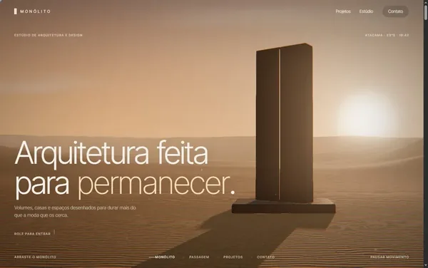
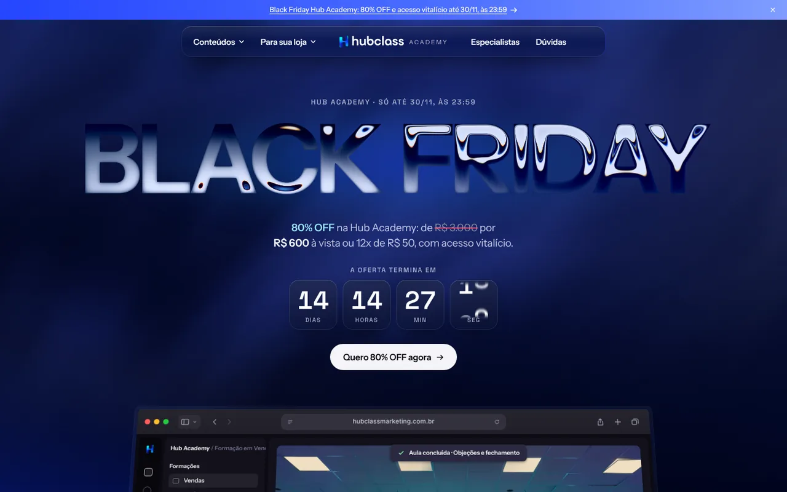
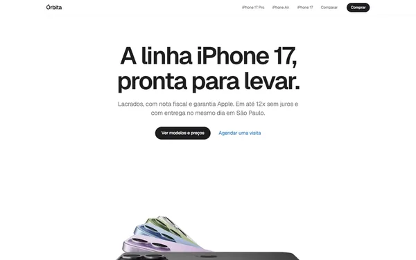
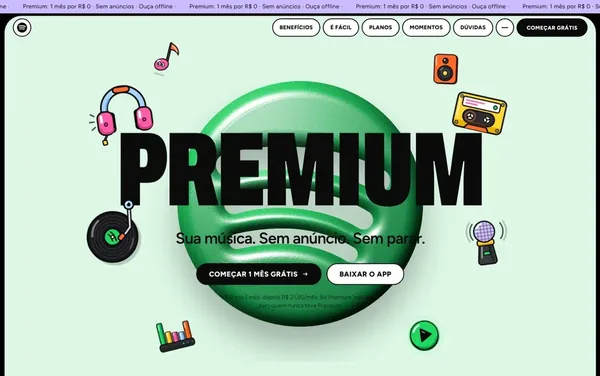

 

Hi! I'm **Gabriel**, a **Brazilian**  front-end developer with a degree in Systems Analysis and Development and **over a year of experience** in the field. I build websites and interfaces with a focus on art direction, fluid animation and performance, and I use **generative AI, agents and MCP** as part of my process, from prototype to deploy.

I like projects where design meets engineering: a 3D journey driven by scroll, a site with a WebGL scene, a landing page with a liquid-metal headline, sites for real brands (a clinic and school, an iPhone brand, a mobile-market education platform, a pizzeria) and a store with Pix checkout.

  
  
  

## Featured projects

<table>
  <tr>
    <td width="25%" valign="top">
      
       <b>Monólito</b>
       Fictional architecture studio as a single scroll-driven 3D journey, with buildings modeled in Blender.
       <code>Three.js</code> <code>WebGL</code> <code>GSAP</code> <code>Blender</code>
       <a href="https://monolito-three.vercel.app">Live demo</a> · <a href="https://github.com/gabrielnovaesdev/monolito">Code</a>
    </td>
    <td width="25%" valign="top">
      
       <b>Upclass</b>
       iPhone brand site with a WebGL 3D bolt and a brand film that follows the scroll.
       <code>Three.js</code> <code>GSAP</code> <code>Lenis</code> <code>Vite</code>
       <a href="https://upclass-beta.vercel.app/">Live demo</a> · <a href="https://github.com/gabrielnovaesdev/UpClass">Code</a>
    </td>
    <td width="25%" valign="top">
      
       <b>Hubclass</b>
       Hub Academy landing with a liquid-metal headline, WebGL smoke and Google Flow loops.
       <code>Vite</code> <code>GSAP</code> <code>OGL</code> <code>Lenis</code>
       <a href="https://hubclass.vercel.app">Live demo</a> · <a href="https://github.com/gabrielnovaesdev/HubClass">Code</a>
    </td>
    <td width="25%" valign="top">
      
       <b>Nébula</b>
       Framework-free studio site: Google Flow (Veo) hero video with a liquid-glass WebGL orb fallback.
       <code>Three.js</code> <code>GSAP</code> <code>Lenis</code> <code>Google Flow</code>
       <a href="https://nebulaproject-nu.vercel.app">Live demo</a> · <a href="https://github.com/gabrielnovaesdev/Nebula">Code</a>
    </td>
  </tr>
  <tr>
    <td width="25%" valign="top">
      
       <b>Pizzaria Cinthya</b>
       Pizzeria landing in Nova Iguaçu (RJ), with an oven video and ordering via WhatsApp.
       <code>HTML</code> <code>CSS</code> <code>JavaScript</code>
       <a href="https://pizzaria-cinthya.vercel.app/">Live demo</a> · client project, private code
    </td>
    <td width="25%" valign="top">
      
       <b>Órbita</b>
       iPhone 17 showcase with WebM videos, 80% lighter and looping.
       <code>JavaScript</code> <code>GSAP</code> <code>Node.js</code>
       <a href="https://orbita-eta-three.vercel.app/">Live demo</a> · <a href="https://github.com/gabrielnovaesdev/Iphone">Code</a>
    </td>
    <td width="25%" valign="top">
      
       <b>Rosazul</b>
       Site for a multidisciplinary clinic and inclusive school in Vila Isabel (RJ).
       <code>HTML</code> <code>CSS</code> <code>JavaScript</code>
       <a href="https://siterosazul.vercel.app/">Live demo</a>
    </td>
    <td width="25%" valign="top">
      
       <b>SpotifyRework</b>
       Spotify Premium landing redesigned as an animated poster wall.
       <code>React</code> <code>TypeScript</code> <code>Tailwind</code> <code>GSAP</code>
       <a href="https://spotifyrework.vercel.app/">Live demo</a> · <a href="https://github.com/gabrielnovaesdev/SpotifyRework">Code</a>
    </td>
  </tr>
</table>

### More projects

| Project | What it is | Stack |
|---|---|---|
| [NovaeStore](https://github.com/gabrielnovaesdev/NovaeStore) | Digital game store with Pix checkout, real-time payment tracking and a secure webhook · [live demo](https://gabrielnovaesdev.github.io/NovaeStore/) | React, TypeScript, Supabase |
| [BarberGo](https://github.com/gabrielnovaesdev/BarberGo) | At-home barber app, from booking to tracking the appointment | React Native, Expo |
| [Portfolio](https://github.com/gabrielnovaesdev/portfolio) | My portfolio: animated intro, reel and a project list with a video of each one | HTML, CSS, GSAP, Lenis |

<b>Coursework and study projects</b>

 

| Project | What it is | Stack |
|---|---|---|
| [APS_POO](https://github.com/gabrielnovaesdev/APS_POO) | Group project for Object-Oriented Programming | Java |
| [Estudos-C](https://github.com/gabrielnovaesdev/Estudos-C) | Logic, data structures and records in C and C++ | C, C++ |
| [Estudos](https://github.com/gabrielnovaesdev/Estudos) | Algorithms in pseudocode with VisuAlg | Portugol |
| [Blog-tecnol-gico](https://github.com/gabrielnovaesdev/Blog-tecnol-gico) | Blog layout, one of my first web projects | HTML, CSS |
| [Jogo-da-velha](https://github.com/gabrielnovaesdev/Jogo-da-velha) | Two-player game in the browser | JavaScript, jQuery |

## How I work

| Practice | How it shows up in my projects |
|---|---|
| **3D art direction** | Scenes with real HDRIs, PBR materials, post-processing and models built by script in Blender. |
| **Generative video on the web** | Loops and intros generated in Google Flow (Veo), with the background removed by script and a WebGL fallback when the video fails to load. |
| **Accessibility and performance** | `prefers-reduced-motion` respected, a static version, keyboard navigation and a lighter version for mobile. |

## Stack

## AI and MCPs

**MCP** (Model Context Protocol) connects the model to the project's tools: in my workflow, Claude controls the browser to test pages and capture screenshots. Media prompts are written with Claude, and the videos and images come out of Google Flow.

## Right now

- Going deeper into React, TypeScript and serverless back-ends with Supabase
- Studying 3D websites, cinematic cameras and scroll-driven animation (GSAP and WebGL)
- Bringing AI-generated media (Google Flow) and MCP agents into my website-building process

 

Open to opportunities and projects. Reach me on <a href="https://linkedin.com/in/gabrielnovaesdev">LinkedIn</a>.
