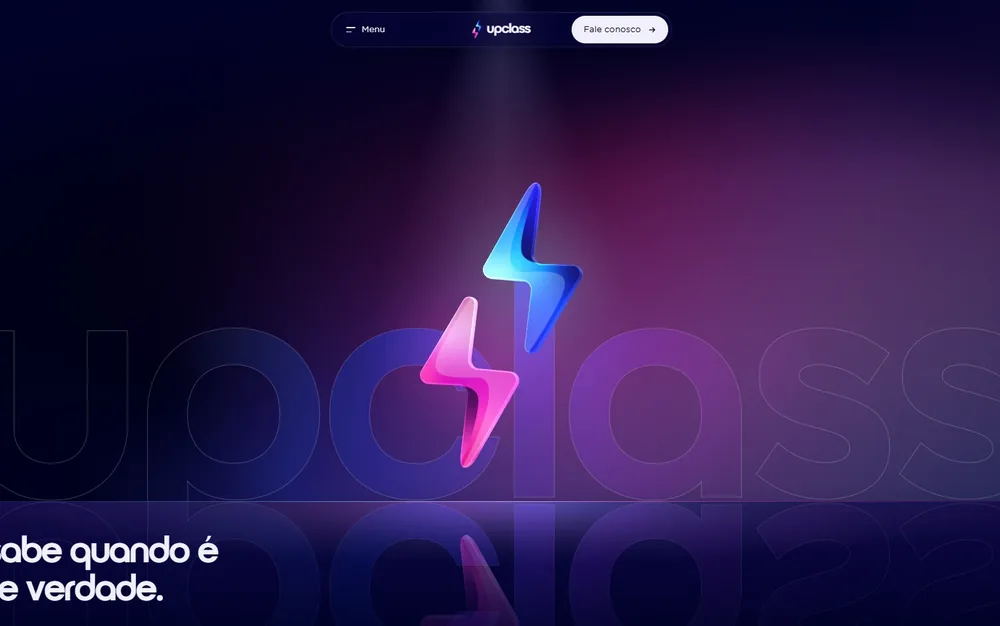
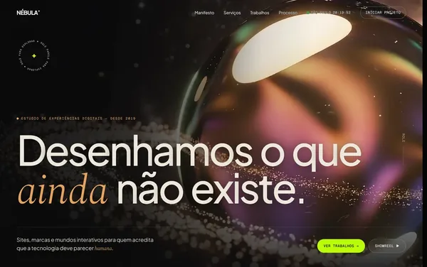

 

Hi! I'm **Gabriel**, a front-end developer with a degree in Systems Analysis and Development and **over a year of experience** in the field. I build websites and interfaces with a focus on art direction, fluid animation and performance, and I use **generative AI, agents and MCP** as part of my process, from prototype to deploy.

I like projects where design meets engineering: a 3D journey driven by scroll, a site with a WebGL scene, a landing page with a liquid-metal headline, sites for real brands (a clinic and school, an iPhone brand, a mobile-market education platform, a pizzeria) and a store with Pix checkout.

  
  

## Featured projects

<table>
  <tr>
    <td colspan="2" valign="top">
      
      <h3>Monólito</h3>
      
Website for a fictional architecture studio built as <b>a single 3D journey driven by scroll</b>: a monolith in the desert opens up, the camera crosses a corridor of light and enters four full-scale projects. Lighting from real HDRIs, cinematic post-processing and buildings modeled with Python scripts in Blender, with a lighter version for mobile.

      
<code>Three.js</code> <code>WebGL</code> <code>GSAP</code> <code>Lenis</code> <code>Blender</code> <code>JavaScript</code>

      <a href="https://monolito-three.vercel.app">Live demo</a> · <a href="https://github.com/gabrielnovaesdev/monolito">Code</a>
    </td>
  </tr>
  <tr>
    <td width="50%" valign="top">
      
      <h3>Upclass</h3>
      
Corporate site for a brand of <b>iPhones and accessories with guaranteed provenance</b>: a 3D lightning bolt in WebGL, a brand film that follows the scroll, and words in perspective with 3D objects. Photos in AVIF and WebP, and a static version for people who prefer less motion.

      
<code>Three.js</code> <code>GSAP</code> <code>Lenis</code> <code>Vite</code>

      <a href="https://upclass-beta.vercel.app/">Live demo</a> · <a href="https://github.com/gabrielnovaesdev/UpClass">Code</a>
    </td>
    <td width="50%" valign="top">
      
      <h3>Hubclass</h3>
      
Black Friday landing page for <b>Hub Academy</b>, an education platform for the mobile market: liquid-metal headline, WebGL smoke, an expert carousel and a countdown. Loops generated in Google Flow.

      
<code>Vite</code> <code>GSAP</code> <code>OGL</code> <code>Lenis</code>

      <a href="https://hubclass.vercel.app">Live demo</a> · <a href="https://github.com/gabrielnovaesdev/HubClass">Code</a>
    </td>
  </tr>
  <tr>
    <td width="50%" valign="top">
      
      <h3>Nébula</h3>
      
Website for a fictional studio, with no framework at all. The hero is a seamless-loop video generated in <b>Google Flow (Veo)</b>, with a fallback in the form of a <b>liquid-glass orb in WebGL</b> and 7,000 particles in orbit.

      
<code>Three.js</code> <code>GSAP</code> <code>Lenis</code> <code>Google Flow</code>

      <a href="https://nebulaproject-nu.vercel.app">Live demo</a> · <a href="https://github.com/gabrielnovaesdev/Nebula">Code</a>
    </td>
    <td width="50%" valign="top">
      
      <h3>Pizzaria Cinthya</h3>
      
Landing page for a <b>restaurant and pizzeria in Nova Iguaçu (Rio de Janeiro)</b>, open since 1990. Hero with a video of the oven, menu, Google reviews and booking or ordering through WhatsApp in one tap. Contacts and links are centralized in a single configuration file.

      
<code>HTML</code> <code>CSS</code> <code>JavaScript</code>

      <a href="https://pizzaria-cinthya.vercel.app/">Live demo</a> · client project, private code
    </td>
  </tr>
  <tr>
    <td width="50%" valign="top">
      
      <h3>Rosazul</h3>
      
Corporate site for a <b>multidisciplinary clinic and inclusive school</b> in Vila Isabel (Rio de Janeiro): specialties, team, health plans and contact with a map.

      
<code>HTML</code> <code>CSS</code> <code>JavaScript</code>

      <a href="https://siterosazul.vercel.app/">Live demo</a>
    </td>
    <td width="50%" valign="top">
      
      <h3>Órbita</h3>
      
Showcase for the iPhone 17 line with the devices in motion. The videos were converted to <b>WebM</b>: 80% lighter and looping seamlessly.

      
<code>JavaScript</code> <code>GSAP</code> <code>Node.js</code>

      <a href="https://orbita-eta-three.vercel.app/">Live demo</a> · <a href="https://github.com/gabrielnovaesdev/Iphone">Code</a>
    </td>
  </tr>
</table>

### More projects

| Project | What it is | Stack |
|---|---|---|
| [SpotifyRework](https://github.com/gabrielnovaesdev/SpotifyRework) | Redesign of the Spotify Premium landing page as a poster wall, with a GSAP motion system · [live demo](https://spotifyrework.vercel.app/) | React, TypeScript, Tailwind, GSAP |
| [NovaeStore](https://github.com/gabrielnovaesdev/NovaeStore) | Digital game store with Pix checkout, real-time payment tracking and a secure webhook · [live demo](https://gabrielnovaesdev.github.io/NovaeStore/) | React, TypeScript, Supabase |
| [BarberGo](https://github.com/gabrielnovaesdev/BarberGo) | At-home barber app, from booking to tracking the appointment | React Native, Expo |
| [Portfolio](https://github.com/gabrielnovaesdev/portfolio) | My portfolio: animated intro, reel and a project list with a video of each one | HTML, CSS, GSAP, Lenis |

<b>Coursework and study projects</b>

 

| Project | What it is | Stack |
|---|---|---|
| [APS_POO](https://github.com/gabrielnovaesdev/APS_POO) | Group project for Object-Oriented Programming | Java |
| [Estudos-C](https://github.com/gabrielnovaesdev/Estudos-C) | Logic, data structures and records in C and C++ | C, C++ |
| [Estudos](https://github.com/gabrielnovaesdev/Estudos) | Algorithms in pseudocode with VisuAlg | Portugol |
| [Blog-tecnol-gico](https://github.com/gabrielnovaesdev/Blog-tecnol-gico) | Blog layout, one of my first web projects | HTML, CSS |
| [Jogo-da-velha](https://github.com/gabrielnovaesdev/Jogo-da-velha) | Two-player game in the browser | JavaScript, jQuery |

## How I work

| Practice | How it shows up in my projects |
|---|---|
| **3D art direction** | Scenes with real HDRIs, PBR materials, post-processing and models built by script in Blender. |
| **Generative video on the web** | Loops and intros generated in Google Flow (Veo), with the background removed by script and a WebGL fallback when the video fails to load. |
| **Accessibility and performance** | `prefers-reduced-motion` respected, a static version, keyboard navigation and a lighter version for mobile. |

## Stack

## AI and MCPs

**MCP** (Model Context Protocol) connects the model to the project's tools: in my workflow, Claude controls the browser to test pages and capture screenshots. Media prompts are written with Claude, and the videos and images come out of Google Flow.

## Right now

- Going deeper into React, TypeScript and serverless back-ends with Supabase
- Studying 3D websites, cinematic cameras and scroll-driven animation (GSAP and WebGL)
- Bringing AI-generated media (Google Flow) and MCP agents into my website-building process

 

Open to opportunities and projects. Reach me on <a href="https://linkedin.com/in/gabrielnovaesdev">LinkedIn</a>.
