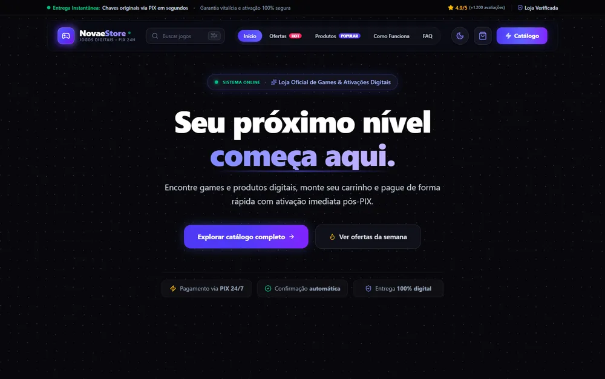
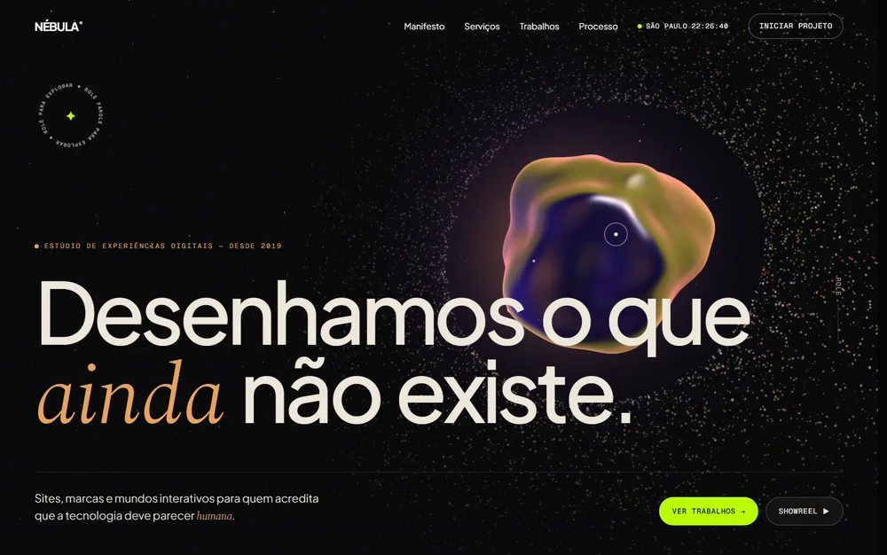
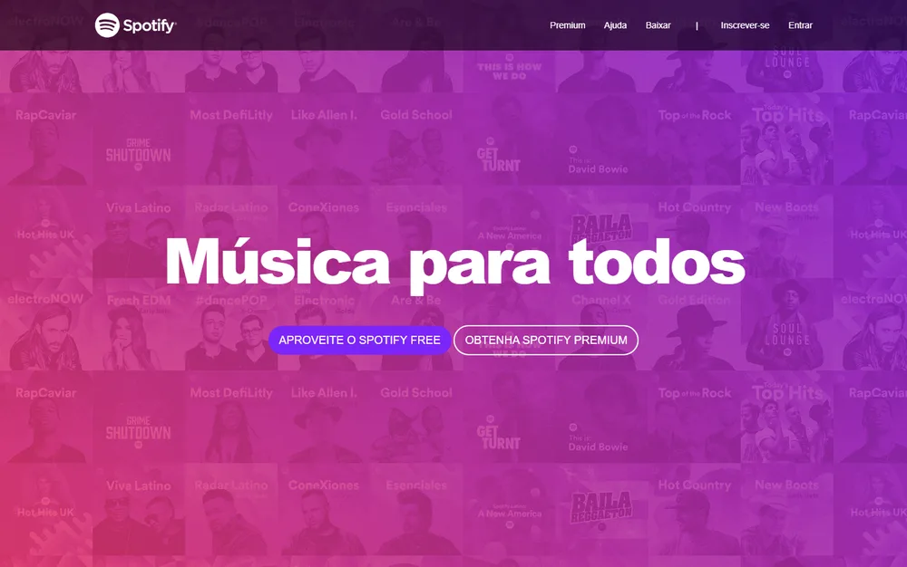

 

Olá! Sou o **Gabriel**, estudante de Análise e Desenvolvimento de Sistemas e desenvolvedor front-end. Construo interfaces web modernas e uso **IA generativa** como parte do processo, do protótipo ao deploy.

Gosto de projetos que juntam visual cuidadoso e engenharia de verdade: uma loja com checkout via Pix e webhooks seguros, um site com cena 3D em WebGL, uma vitrine com animações em vídeo otimizadas para a web.

  
  

## Projetos em destaque

<table>
  <tr>
    <td width="50%" valign="top">
      
      <h3>NovaeStore</h3>
      
Loja de jogos digitais com carrinho, checkout via <b>Pix</b>, acompanhamento do pagamento em tempo real e webhook com autenticação resistente a ataques de tempo.

      
<code>React</code> <code>TypeScript</code> <code>Supabase</code> <code>Edge Functions</code> <code>Postgres</code>

      <a href="https://gabrielnovaesdev.github.io/NovaeStore/">Ver ao vivo</a> · <a href="https://github.com/gabrielnovaesdev/NovaeStore">Código</a>
    </td>
    <td width="50%" valign="top">
      
      <h3>Nébula</h3>
      
Site de um estúdio fictício com <b>orbe de vidro líquido em WebGL</b>, 7 mil partículas em órbita e rolagem cinematográfica, sem nenhum framework.

      
<code>Three.js</code> <code>GSAP</code> <code>Lenis</code> <code>JavaScript</code>

      <a href="https://nebulaproject-nu.vercel.app">Ver ao vivo</a> · <a href="https://github.com/gabrielnovaesdev/Nebula">Código</a>
    </td>
  </tr>
  <tr>
    <td width="50%" valign="top">
      
      <h3>Órbita</h3>
      
Vitrine da linha iPhone 17 com as animações oficiais dos aparelhos, convertidas para <b>WebM</b>: 80% mais leves e em loop contínuo.

      
<code>JavaScript</code> <code>GSAP</code> <code>Node.js</code> <code>ffmpeg</code>

      <a href="https://github.com/gabrielnovaesdev/Iphone">Código</a>
    </td>
    <td width="50%" valign="top">
      
      <h3>Clone do Spotify</h3>
      
Recriação responsiva da landing page do Spotify, feita para treinar layout, semântica e responsividade.

      
<code>HTML</code> <code>CSS</code> <code>Bootstrap</code>

      <a href="https://gabrielnovaesdev.github.io/Clone-de-Interface-do-Spotify/">Ver ao vivo</a> · <a href="https://github.com/gabrielnovaesdev/Clone-de-Interface-do-Spotify">Código</a>
    </td>
  </tr>
</table>

<b>Outros repositórios</b>

 

| Projeto | O que é | Stack |
|---|---|---|
| [BarberGo](https://github.com/gabrielnovaesdev/BarberGo) | App de agendamento para barbearias, com mapa e calendário | React Native, Expo |
| [APS_POO](https://github.com/gabrielnovaesdev/APS_POO) | Projeto acadêmico em grupo de Programação Orientada a Objetos | Java |
| [Estudos](https://github.com/gabrielnovaesdev/Estudos) | Exercícios e desafios de programação | Vários |
| [Estudos-C](https://github.com/gabrielnovaesdev/Estudos-C) | Lógica e algoritmos em C | C |

## Stack

  

  

**IA no dia a dia:** uso modelos generativos para prototipar, revisar código e automatizar tarefas repetitivas.

  
  
  
  
  

## Agora

- Aprofundando em React, TypeScript e back-end serverless com Supabase
- Estudando automação de processos com IA

 

Aberto a oportunidades e projetos. Me chame no <a href="https://linkedin.com/in/gabrielnovaesdev">LinkedIn</a>.
